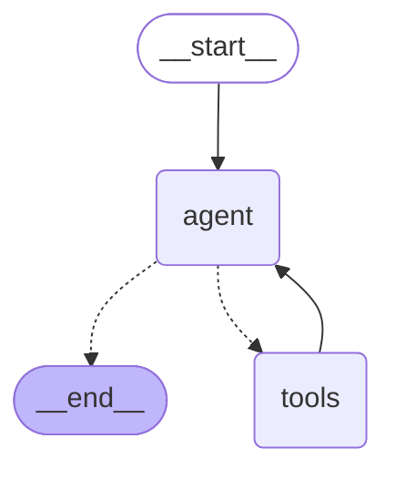

# GPU Assistant

A conversational assistant to query shared **GPU infrastructure** — which GPUs exist, how many of
each there are, how much memory they have, and **when they are available**. It is built on
**LangGraph** with a single tool-calling agent and a locally-hosted LLM served by **llama.cpp**.

The core rule of the challenge is baked into the design: **the assistant never invents data.**
Every fact about the infrastructure comes from a tool call against the in-memory inventory and
the reservations, and the API streams the full tool trace so you can verify it.

> Example
> ```
> User:      Quais GPUs existem na infraestrutura?
> Assistant: Temos NVIDIA A100, NVIDIA L40S, NVIDIA RTX 4090, NVIDIA H100 e NVIDIA A40.
> User:      Existem duas A100 disponíveis?
> Assistant: Sim, existem duas A100 disponíveis.
> ```
> The assistant answers in the language the user writes in.

## Architecture



```
┌──────────┐      ┌──────────┐      ┌───────────────┐
│ Streamlit│ ───▶ │ FastAPI  │ ───▶ │ LangGraph     │
│   UI     │ ◀─── │  /chat   │ ◀─── │ agent + tools │
└──────────┘ NDJSON└─────────┘      └──────┬────────┘
                                           │ tool calls
                                    ┌──────▼────────┐     ┌──────────────┐
                                    │ domain (pure) │     │ llama.cpp     │
                                    │ list of dicts │     │ (Docker, LLM) │
                                    └───────────────┘     └──────────────┘
```

- **`app/data.py`** — the inventory as a plain in-memory `list[dict]`, plus a loader for
  `reservations.json`. No database.
- **`app/domain.py`** — pure, typed functions over that data. No LangChain import. Returns plain
  dicts; invalid input returns `{"error": ..., "valid_gpus": [...]}` instead of raising.
- **`app/tools.py`** — thin `@tool` wrappers whose docstrings are the schema the LLM sees:
  `list_gpus`, `get_gpu` (by name), `filter_gpus_by_memory` (`gte`/`gt`/`lte`/`lt`/`eq`),
  `check_availability`, `list_reservations`, `find_next_slot`.
- **`app/guardrails.py`** — sanitizes user input and validates the GPU name at the tool boundary.
- **`app/graph.py`** — the `agent ↔ tools` LangGraph (`MessagesState`, `InMemorySaver` for
  per-`thread_id` memory).
- **`app/llm.py`** — `ChatOpenAI` pointed at the llama.cpp server.
- **`app/api.py`** — FastAPI; streams the tool trace as NDJSON.
- **`ui/app.py`** — Streamlit chat + per-answer tool-trace panel + LLM status.

### Inventory

| GPU | Quantity | Memory (GB) |
|---|---|---|
| NVIDIA A100 | 4 | 80 |
| NVIDIA L40S | 6 | 48 |
| NVIDIA RTX 4090 | 3 | 24 |
| NVIDIA H100 | 2 | 80 |
| NVIDIA A40 | 4 | 48 |

The inventory lives in `app/data.py` as a simple list of dicts — there is no database.

### Reservations & availability

Reservations live in **`reservations.json`** as **offsets in hours relative to "now"**, so the
demo always has interesting state without editing absolute dates that would go stale:

```json
{"gpu_model": "NVIDIA A100", "quantity": 2, "start_offset_h": 0, "end_offset_h": 3, "user": "alice"}
```

At load time each offset is resolved against the current time into an ISO-8601 half-open interval
`[start, end)`. Availability is then pure arithmetic over those intervals (no SQL):

- **At an instant** = `quantity − units reserved then`.
- **Over a window** = `quantity − peak simultaneous usage` (a sweep over reservation boundaries),
  so "available" means the request holds for the *whole* window.
- **`find_next_slot`** scans forward from now over reservation boundaries for the earliest window
  of the requested length where enough units are free.

Relative dates ("tomorrow 2pm", "amanhã às 14h") are converted to ISO-8601 by the model, which is
given the current date/time in its system prompt; `domain` validates them. Reservations are
read-only here (creating one via chat is a documented next step).

## Running it

Prerequisites: [`uv`](https://docs.astral.sh/uv/) and Docker.

Only the LLM runs in Docker; the FastAPI backend and the Streamlit UI run locally via `uv`.

### 1. Start the LLM (llama.cpp in Docker)

```bash
docker compose up
```

First boot downloads the GGUF (~2 GB, Qwen2.5-3B-Instruct Q4_K_M) into a named volume, then
serves an OpenAI-compatible API on `http://localhost:8080/v1` with tool calling enabled. Wait
until `GET http://localhost:8080/health` is healthy before step 2.

To use a smaller/faster model, change the `-hf` tag in `docker-compose.yml` (e.g.
`Qwen/Qwen2.5-1.5B-Instruct-GGUF:q4_k_m`); the default is the 3B because it does tool calling
more reliably.

> Note: on macOS, Docker has no Metal/GPU access, so inference is CPU-only — fine for trying it
> out, just not fast.

### 2. Start the API and the UI (locally, via uv)

```bash
uv sync
```

```bash
uv run uvicorn app.api:app --reload --port 8000
```

```bash
uv run streamlit run ui/app.py
```

Open the Streamlit URL and chat. `GET /health` reports whether the LLM is reachable.

> If you see `Address already in use`, a server is already bound to that port (e.g. a previous
> run). Stop it first: `pkill -f "uvicorn app.api"` for the API, or `docker compose down` for
> the LLM.

Copy `.env.example` to `.env` to override any defaults (model, ports…).

## Tests

```bash
uv run pytest
```

- `tests/test_domain.py` — inventory, name normalization, the memory filter
  (`gte`/`gt`/`lte`/`lt`/`eq`), availability math (instant, window peak-concurrency, half-open
  edges, `find_next_slot`), validation errors, and the guardrails. Uses a pinned clock and
  injected reservations — fully deterministic, no server.
- `tests/test_graph.py` — drives the graph with a **scripted fake chat model**, so it verifies
  the read→tools→answer loop with **no LLM server required** (CI-friendly).

## Design decisions

- **Tool calling, not data-in-prompt.** The inventory never goes into the system prompt. The
  model must call a tool to learn any fact, which structurally prevents hallucinated numbers and
  keeps the answer auditable via the streamed trace.
- **Domain decoupled from the framework.** `domain.py` has zero LangChain dependencies, so the
  rules are trivially unit-testable and could be reused behind a different interface.
- **llama.cpp via its OpenAI-compatible API.** `llama-server` with `--jinja` + a Qwen2.5-Instruct
  GGUF supports function calling, so we drive it with `langchain-openai`'s `ChatOpenAI`. Swapping
  providers (Ollama, a hosted API) is a one-function change in `app/llm.py`.
- **A single agent.** This is a read-only Q&A assistant; one `agent ↔ tools` loop is the simplest
  thing that works and is easy to explain. A supervisor / multi-agent setup would add moving parts
  with no benefit here.
- **Input guardrails.** User text is sanitized (control chars stripped, length capped, obvious
  prompt-injection phrasing neutralized) before reaching the model, and the GPU name is validated
  at the tool boundary.
- **No database — a list of dicts and a JSON file.** The inventory is a static list; reservations
  are a small `reservations.json`. Both are trivial to read, edit and test, which fits "prefer a
  simple solution". Swapping the JSON loader for a real store later touches a single function.
- **Docker for the model only.** The Python app runs locally for fast iteration; only the LLM,
  the one heavy and environment-sensitive piece, is containerized.

## Limitations & next steps

Kept out to stay simple; natural extensions:

- **Reservation creation** via chat, with a human-in-the-loop confirm step (LangGraph `interrupt`)
  before any write — the reservations are read-only today.
- **A real store** (SQLite/Postgres) if reservations need to persist and be written concurrently,
  in place of the JSON seed.
- **Durable memory** (replace `InMemorySaver` with a real checkpointer) and **authentication**.
- **Evaluation set** (PT/EN cases with expected tools and substrings) run against the real model.
- **Real GPUs** via NVML / Kubernetes instead of the simulated inventory.

## Example conversations

```
User:      Quais GPUs têm 80GB?
Assistant: NVIDIA A100 e NVIDIA H100 têm 80GB.

User:      Do you have a B200?
Assistant: No — the B200 is not part of the infrastructure. Available GPUs are
           NVIDIA A100, L40S, RTX 4090, H100 and A40.

User:      Existem duas A100 disponíveis?
Assistant: Sim, existem 4 A100 na infraestrutura, então duas estão disponíveis.

User:      Which GPUs have less than 48GB?
Assistant: Only the NVIDIA RTX 4090 (24GB).

User:      Quantas A100 estão livres agora?
Assistant: Há 2 NVIDIA A100 livres agora (de 4 no total).

User:      Quando vou ter 2 H100 livres por 1 hora?
Assistant: As 2 H100 estão reservadas; a próxima janela de 1h para 2 unidades
           começa amanhã por volta deste horário.
```
